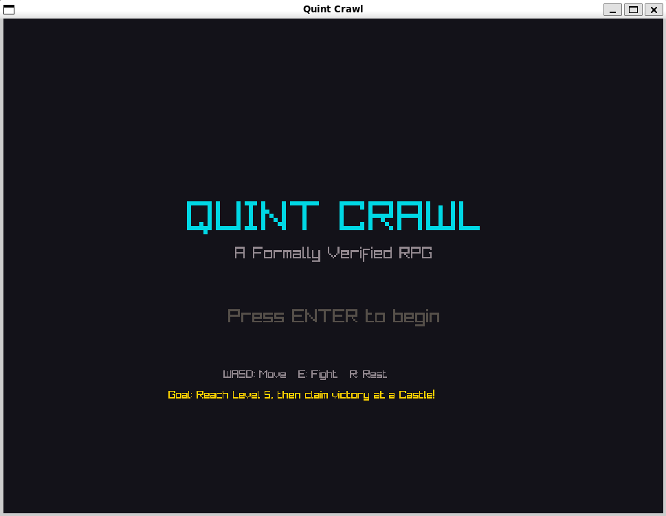
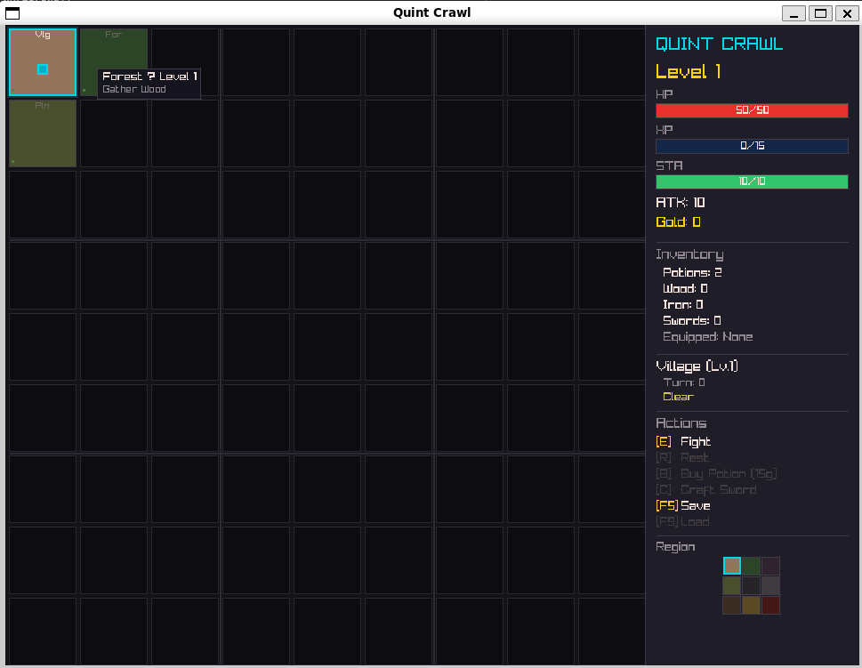
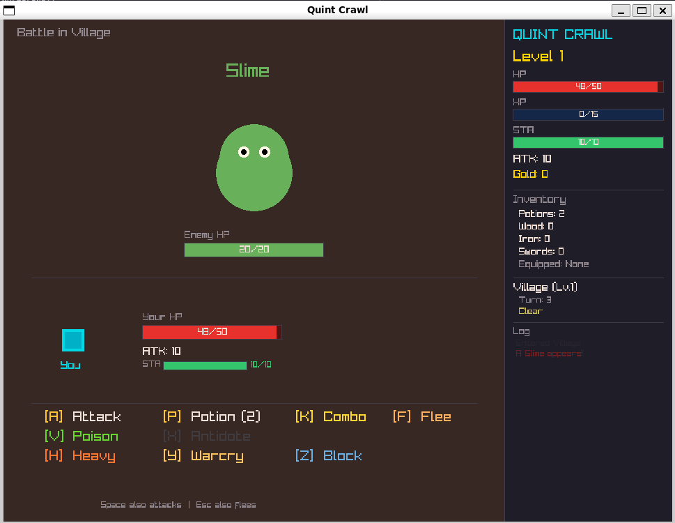

# Quint Crawl — Formally Verified RPG

A raylib RPG game built on formally verified game logic. Every game rule is specified in [Quint](https://quint-lang.org/), tested via Model-Based Testing (MBT), and implemented in [Odin](https://odin-lang.org/).

Inspired by: [Model-Based Testing for D&D](https://www.loskutoff.com/blog/model-based-testing-dnd/)





## The Game

**Quint Crawl** is a turn-based RPG rendered with raylib. Explore a 9x9 world grid (81 zones across 5 difficulty levels), fight enemies, gather resources, craft gear, and level up to conquer the Castle.

```bash
just play             # build and run the game
```

The game logic in `quint_crawl/` is the single source of truth — shared by both the raylib game and the MBT test harness. Every state transition is formally specified and verified.

## Controls

### Movement

| Key | Action |
|-----|--------|
| WASD | Move between zones |
| J | Fast travel (between unlocked village waypoints) |

### Combat — Sword

| Key | Action |
|-----|--------|
| E | Initiate fight |
| A | Basic attack |
| K | Combo (3-hit chain: Slash → Thrust → Finisher) |
| H | Heavy strike (2x damage, cooldown) |

### Combat — Actions & Skills

| Key | Action |
|-----|--------|
| Y | Battle cry (ATK buff) |
| Z | Shield block |
| N | Counter-attack (block + retaliatory hit) |
| I | Fortify (extended DEF buff) |
| F | Flee |

### Combat — Tactical

| Key | Action |
|-----|--------|
| P | Use potion |
| V | Apply poison (venom sac) |
| X | Antidote |

### Exploration

| Key | Action |
|-----|--------|
| R | Rest (restore stamina) |
| G | Gather wood |
| M | Mine iron |

### Village

| Key | Action |
|-----|--------|
| B | Buy potions |
| C | Craft sword (Level 2+) |
| Q | Equip |
| T | Repair sword |
| O | Craft venom sac |
| U | Respec skills |
| \ | Salvage sword |
| = | Upgrade salvage level |
| 1–7 | Unlock skill (when points available) |
| 8–0 | Enchant sword slots 1–3 |
| L | Claim victory (at Level 5 Castle, after the Boss) |

### Companions

| Key | Action |
|-----|--------|
| , | Adopt local companion |
| . | Feed companion |
| ; | Dismiss companion |
| ' | Companion command (in combat) |

### System

| Key | Action |
|-----|--------|
| F5 | Save |
| F9 | Load |

See the HUD sidebar for zone-specific actions.

## Features

- **World** — 9x9 grid, 5 difficulty levels, biome tiling (3x3 pattern repeats across regions), fog of war, HUD minimap, mouse hover tooltips, per-zone weather (Clear/Rain/Fog/Storm) affecting combat/gathering/movement, village waypoints with fast travel.
- **Combat** — turn-based, stamina-gated actions, 3-hit combo chain with damage multipliers, cooldown abilities (heavy strike, battle cry, fortify, counter-attack), status effects (poison, ATK/DEF buffs) with turn-based ticking, enemy respawn timer (5-turn cooldown after a kill), dual weapon types (sword vs. battery-powered pistol; `weapon_type` gate routes combat actions).
- **Bestiary** — data-driven catalog of 200 named enemies across 20 archetypes (4 per tier, 5 tiers), 6 trait tags (Undead/Beast/Elemental/Construct/Humanoid/Aberration), trait-keyed secondary loot drops.
- **Elemental system** — 4-element cycle (Fire > Ice > Lightning > Earth > Fire) with 2x/1x/0.5x damage multipliers.
- **Companions** — data-driven species catalog (Wolf/Hawk/Turtle/Fox/Bear/Owl/Lynx/Sprite) with biome-gated adoption, trait affinities (Attacker/Defender/Scout/Support), rarity tiers (Common/Rare/Legendary), loyalty-on-combat loop (inactive below LOW_LOYALTY until fed), in-combat command, village training to raise rarity, and a 3-stage companion quest chain. The spec verifies the abstract (trait × rarity) effect space; Odin grows the catalog freely without code changes.
- **Progression** — XP/level-up, skill tree with 3 branches (Offense/Defense/Utility), 1 point per level, respec at village, 3 prerequisite-gated quests (Slime Slayer → Venture Forth → Castle Conqueror) tracked in the HUD, Castle Boss encounter gates the final victory claim.
- **Items & crafting** — resource gathering (wood, iron), level-gated sword crafting (Lv2+), sword durability with village repair, salvage system (upgradeable 1–3), 3-slot weapon enchantment (fire/ice/vampiric/lightning; fire/ice mutually exclusive), venom sac crafting, holy water crafting (holy_dust + wood → out-of-combat full heal), fire scrolls (bypass mana gate), loot drops with pity-counter guarantee, inventory capacity (30 items) enforced across gathering/shopping/loot.
- **Persistence & polish** — save/load snapshot with full state round-trip; post-processing effects (zone tint, chromatic aberration, low-HP pulse, level-up bloom, poison overlay).

## How MBT works

```
specs/*.qnt  ──[quint run --mbt]──▶  traces/*.itf.json  ──[odin test]──▶  pass/fail
                                          │
                 Odin implementation  ◀───┘
                 (*_mbt/*.odin)        replayed against spec expectations
```

1. **Write a Quint spec** — state variables, actions (state transitions), invariants (properties that must always hold)
2. **Generate traces** — Quint explores the state space nondeterministically and records execution traces in ITF (Intermediate Trace Format)
3. **Write Odin glue** — a step handler (dispatches action names to your code) and a state getter (reads your implementation's state back for comparison)
4. **Replay** — the MBT runner walks each trace step, mutates your implementation, and checks that every state variable matches the spec's expectation

## Project structure

```
quint_crawl/           Shared game logic (Game_State, all action procs, constants)
quint_crawl_game/      Raylib game executable (rendering, input, UI, shaders)
  assets/              GLSL shaders (effects.fs)
quint_mbt/             Shared Odin library: ITF parser + trace replayer
quint_crawl_mbt/       MBT harness for the integrated game spec
specs/                 Quint formal specifications
  core/                Character fundamentals (rpg, healing, leveling, stamina)
  combat/              Combat systems (combat, combat_full, status, cooldown, elemental)
  items/               Equipment & crafting (equip, durability, enchantment, crafting, salvage, ...)
  economy/             Trade & loot (shop, dynamic_shop, trade, loot)
  world/               Exploration (world_grid, trap, respawn, companion)
  social/              Progression & social (party, quest, skill_tree, reputation, summoning)
  quint_crawl.qnt      Integrated game spec
mbt/                   Per-module Odin MBT test harnesses (mirroring specs/ layout)
  core/                ...
  combat/              ...
  items/               ...
  economy/             ...
  world/               ...
  social/              ...
traces/                Generated ITF trace files (.itf.json)
docs/                  Design documents (asset specs, etc.)
justfile               Task runner for common workflows
```

## Modules

| Module | Spec | Invariants |
|--------|------|------------|
| **rpg** | Character with HP, attack, inventory | Inventory bounded, HP can go negative (design question) |
| **trade** | Two-player item trading | Items conserved, inventories bounded |
| **equip** | Equipment slots (weapon/armor/accessory) | Item conservation, no duplicates, inventory bounded |
| **healing** | HP + consumable potions | HP capped at max, potions non-negative |
| **stacking** | Quantity-based item stacks | Quantities non-negative, total bounded |
| **shop** | Gold economy with buy/sell | Gold conserved, items conserved, gold non-negative |
| **combat** | Turn-based two-character combat | Turns alternate, HP bounded by init, attack constant |
| **status** | Poison/buff effects with duration | Durations non-negative, effects consistent, HP capped |
| **crafting** | Recipe-based item crafting | Materials non-negative, total mass conserved |
| **party** | 3-member party + shared stash | Items conserved across all inventories |
| **leveling** | XP gain and level-up thresholds | XP monotonic, stats match level deterministically |
| **cooldown** | Ability cooldown timers | Cooldowns non-negative, bounded by max |
| **quest** | Multi-step quests with prerequisite chains | Prerequisites respected, completion monotonic |
| **durability** | Weapon/armor degradation and repair | Broken iff durability==0, durability bounded |
| **loot** | Loot drops with pity/guarantee system | Pity counter bounded, rare drought capped |
| **respawn** | Enemy respawn with zone capacity | Population conserved, zones bounded |
| **dynamic_shop** | Shop with supply-based dynamic pricing | Gold conserved despite variable prices |
| **combat_full** | Combat + equipment + status effects | Effects consistent, poison-between-turns death |
| **capacity_craft** | Crafting with inventory capacity limits | Capacity bounded, atomic craft-or-reject |
| **gated_craft** | Level-gated crafting recipes + combat XP | Recipe access matches level, XP monotonic |
| **stamina** | Action stamina with regen | Stamina bounded, non-negative, constants stable |
| **skill_tree** | Prerequisite-based skill unlocks | Prerequisites respected, points conserved |
| **reputation** | Faction reputation with rivalries | Standings bounded [-100, 100] |
| **summoning** | Timed summon slots (3 max) | Count consistent, inactive zeroed, durations non-negative |
| **world_grid** | 9x9 level-gated zone grid with biome tiling | Position bounded, zone matches, level gates respected |
| **elemental** | 4-element damage affinity (Fire/Ice/Lightning/Earth) | Elements bounded, multiplier matrix consistent, damage symmetric |
| **enchantment** | 3-slot weapon enchantments (fire/ice/vampiric/lightning) | Mutual exclusion, slot count bounded, enchantment validity |
| **trap** | Trap/hazard system on 2x2 grid with perception | Triggered implies present, HP bounded, perception bounded |
| **companion** | Companion/pet system (wolf/hawk/turtle) with loyalty | Loyalty bounded, passives match type, one active companion |
| **salvage** | Salvage/disenchant inverse crafting | Level-based output, material conservation, non-negative quantities |
| **auction** | Timed auction house with bidding | Bids monotonic, winner pays highest, gold conserved |
| **faction** | Alliance/betrayal faction system | Faction membership consistent, betrayal costs enforced |
| **fast_travel** | Waypoint-based fast travel | Unlocked waypoints persistent, travel requires unlock |
| **dialogue** | Branching dialogue trees | Node reachability, visited tracking, choice validity |
| **fog_of_war** | Exploration reveal system | Revealed tiles monotonic, visibility radius bounded |
| **permadeath** | Permadeath with legacy bonuses | Death permanent, legacy bonuses carry forward |
| **bounty** | Bounty board quest system | Bounty rewards match difficulty, completion tracked |
| **quint_crawl** | Full RPG game state machine (9x9 grid, 5 levels, data-driven companions) | HP bounded, gold non-negative, level bounded, position bounded, visited in bounds, waypoint is service zone, quantities non-negative, level gates respected, durability bounded, combo bounded, stamina bounded, cooldowns bounded (incl. fortify), cooldowns only in combat, loot pity bounded, status effects bounded, status only in combat, last kill turn bounded, broken sword gives no sword/enchant bonus, weather deterministic, skill points non-negative, skill prereqs respected, venom sac non-negative, enemy element bounded, enchant slots bounded, no fire/ice incompatible, enemy element only in combat, inventory bounded, salvage level bounded, quest counters bounded, quest prereqs respected, companion trait+rarity bounded, loyalty bounded, inactive=no loyalty, companion inactive zeroed, comp atk/def derived effects bounded, companion quest counters+prereqs respected, victory preconditions, win condition correct, victory requires castle boss defeated |

## Quick start

```bash
just play            # build and run the game
just build-game      # build without running

just check           # typecheck all specs
just traces          # generate MBT traces for all specs
just test            # run all Odin MBT tests
just all             # check + traces + test
just retest          # traces + test

just check-one rpg             # typecheck one spec
just test-one rpg              # test one module
just trace rpg rpg_run         # regenerate one trace
just trace-crawl               # regenerate quint_crawl traces (5x, 100k samples)
just test-crawl                # regen traces + run crawl MBT tests
just verify NAME MAIN INVARIANT # run invariant check (100k traces, 20 steps)
```

## Prerequisites

- [Odin](https://odin-lang.org/) (with vendor:raylib)
- [Quint](https://quint-lang.org/) (tested with 0.32.0)
- [just](https://github.com/casey/just) (task runner)
- X server or WSLg (if running on WSL)

## Docs

- [Asset Design Guide](docs/assets-design.md) — sprite specs for V2 visual upgrade (26 required assets)
